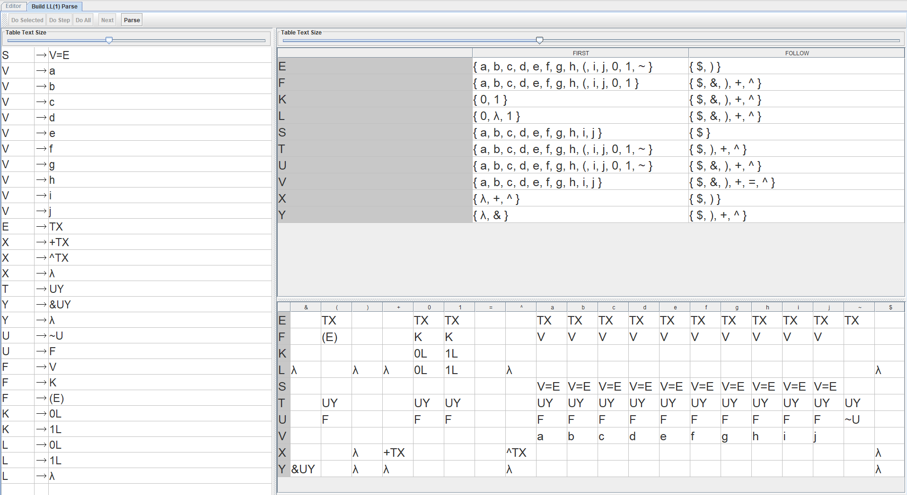

# Полученная LL(1)-грамматика

**Файл модели:** [`grammar_ll1.jff`](grammar_ll1.jff).

## Правила грамматики

```text
S -> V=E
V -> a | b | c | d | e | f | g | h | i | j
E -> TX
X -> +TX | ^TX | ε
T -> UY
Y -> &UY | ε
U -> ~U | F
F -> V | K | (E)
K -> 0L | 1L
L -> 0L | 1L | ε
```

`V` — переменная; `E`, `T`, `U` — уровни приоритета (аддитивный, мультипликативный, унарный); `X`, `Y` — продолжения выражений; `F` — операнд; `K`, `L` — двоичная константа (непустая цепочка из `0` и `1`). Левая рекурсия устранена, группировка бинарных операций правая. Присваивание `V=E` — корневое правило `S`.

## Множества FIRST и FOLLOW

| Нетерминал | FIRST | FOLLOW |
|---|---|---|
| `S` | `a`–`j` | `$` |
| `V` | `a`–`j` | `$ & ) + = ^` |
| `E` | `~ ( 0 1 a`–`j` | `$ )` |
| `X` | `+ ^ ε` | `$ )` |
| `T` | `~ ( 0 1 a`–`j` | `$ ) + ^` |
| `Y` | `& ε` | `$ ) + ^` |
| `U` | `~ ( 0 1 a`–`j` | `$ & ) + ^` |
| `F` | `( 0 1 a`–`j` | `$ & ) + ^` |
| `K` | `0 1` | `$ & ) + ^` |
| `L` | `0 1 ε` | `$ & ) + ^` |

## Таблица предсказывающего анализа M[A, a]

Сжатая запись: группа символов означает отдельные клетки с одной и той же продукцией; остальные клетки — ошибка.

| A | Символ предпросмотра a | Продукция |
|---|---|---|
| `S` | `a`–`j` | `S → V=E` |
| `V` | `a`, `b`, …, `j` соответственно | `V → a`, `V → b`, …, `V → j` |
| `E` | `~ ( 0 1 a`–`j` | `E → TX` |
| `X` | `+` / `^` / `$ )` | `X → +TX` / `X → ^TX` / `X → ε` |
| `T` | `~ ( 0 1 a`–`j` | `T → UY` |
| `Y` | `&` / `$ ) + ^` | `Y → &UY` / `Y → ε` |
| `U` | `~` / `( 0 1 a`–`j` | `U → ~U` / `U → F` |
| `F` | `a`–`j` / `0 1` / `(` | `F → V` / `F → K` / `F → (E)` |
| `K` | `0` / `1` | `K → 0L` / `K → 1L` |
| `L` | `0` / `1` / `$ & ) + ^` | `L → 0L` / `L → 1L` / `L → ε` |



## Обоснование LL(1)
Альтернативы каждого нетерминала имеют попарно непересекающиеся FIRST; для `X`, `Y`, `L` непустые альтернативы не пересекаются с FOLLOW при выборе ε. Таблица не содержит клеток с двумя продукциями, поэтому грамматика LL(1).
