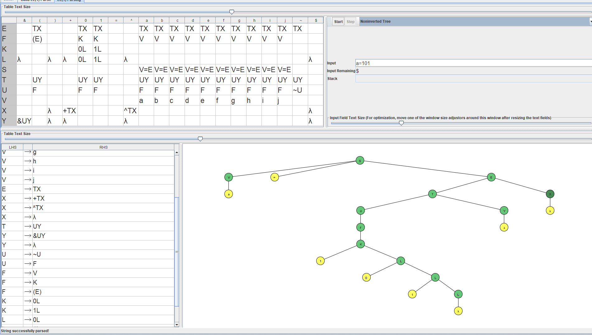
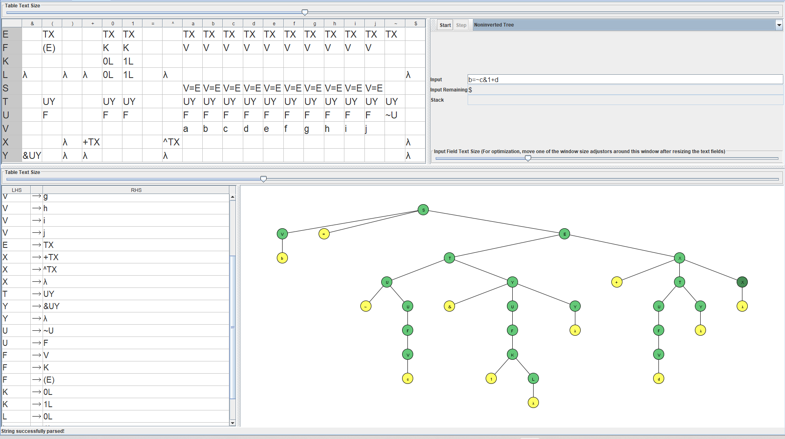
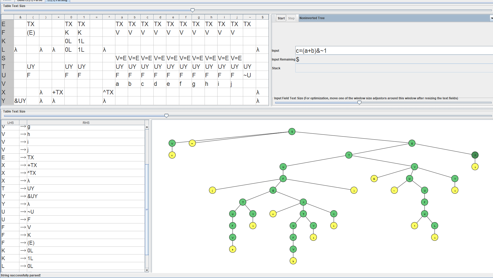
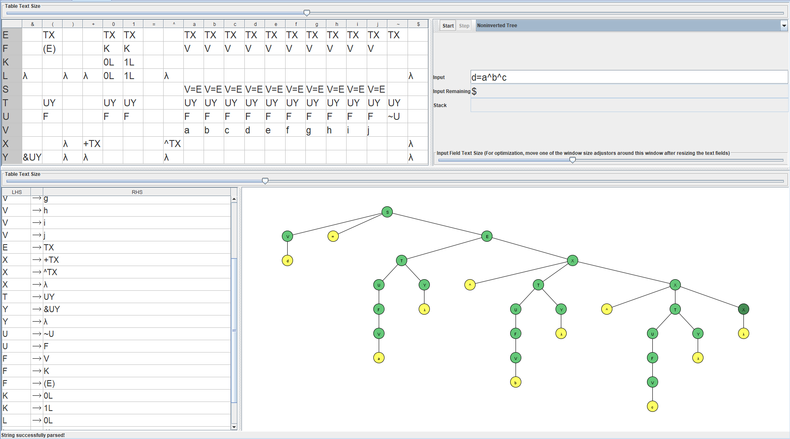
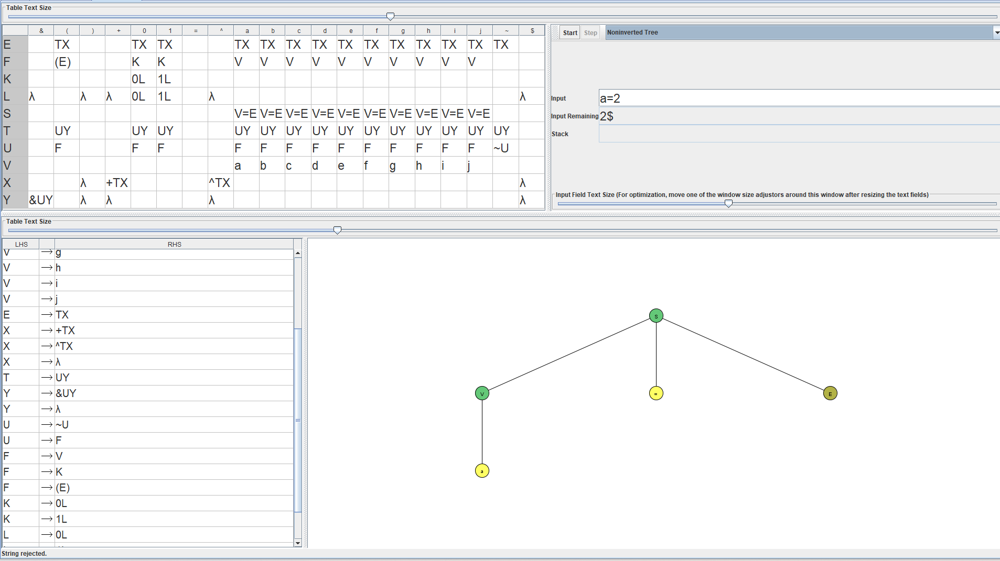
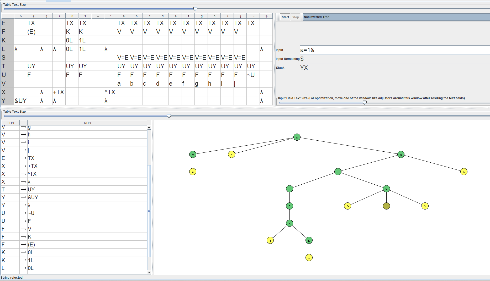

# Распознавание тестовых цепочек (LL(1), JFLAP)

| № | Цепочка | Результат | Что проверяется |
|---:|---|---|---|
| 1 | `a=101` | Accepted | двоичная константа |
| 2 | `b=~c&1+d` | Accepted | приоритеты операций |
| 3 | `c=(a+b)&~1` | Accepted | скобки и отрицание |
| 4 | `d=a^b^c` | Accepted | вторая аддитивная операция |
| 5 | `a=2` | Rejected | недвоичная цифра |
| 6 | `a=1&` | Rejected | отсутствует операнд |

**1. `a=101` — принято.**

**2. `b=~c&1+d` — принято.**

**3. `c=(a+b)&~1` — принято.**

**4. `d=a^b^c` — принято.**

**5. `a=2` — отклонено.**

**6. `a=1&` — отклонено.**

