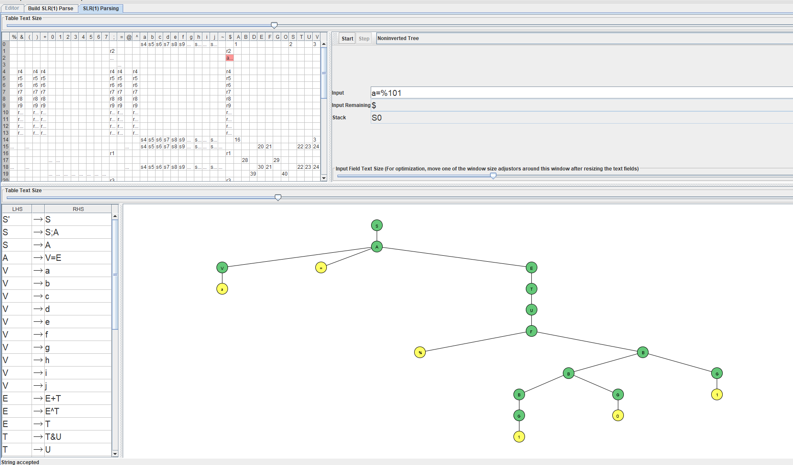
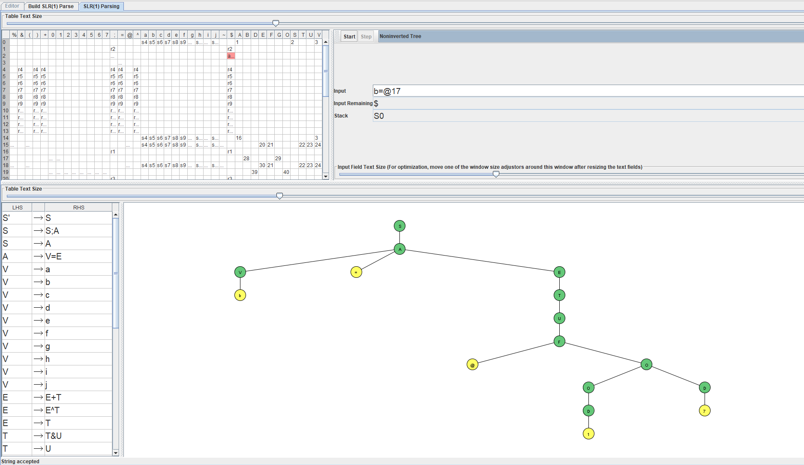
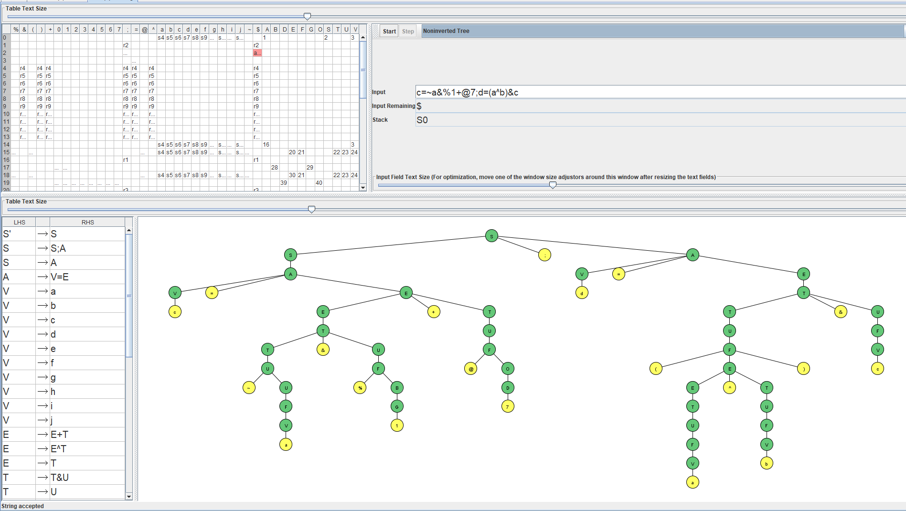
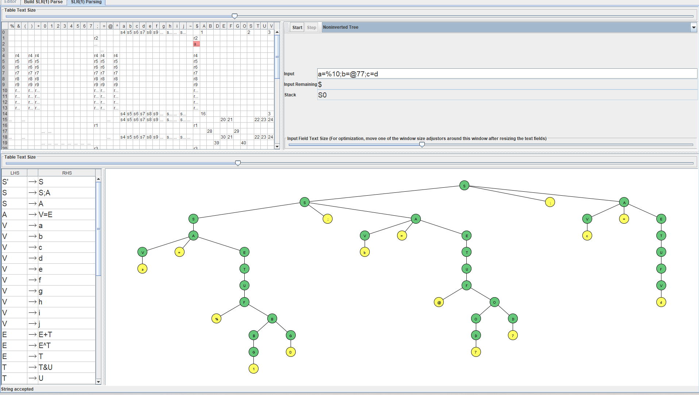
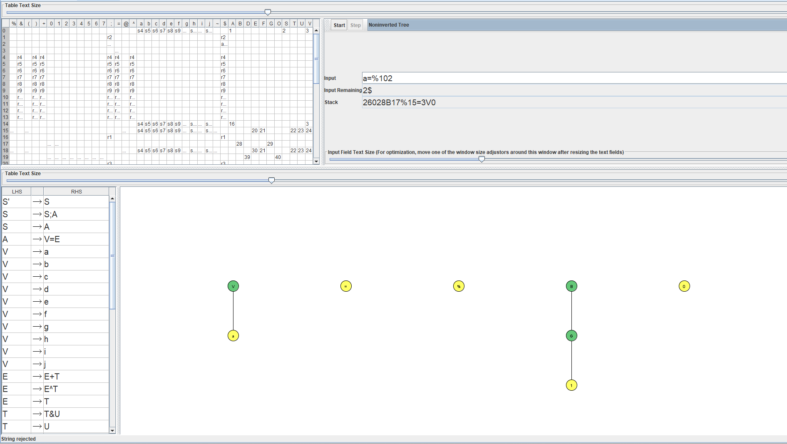
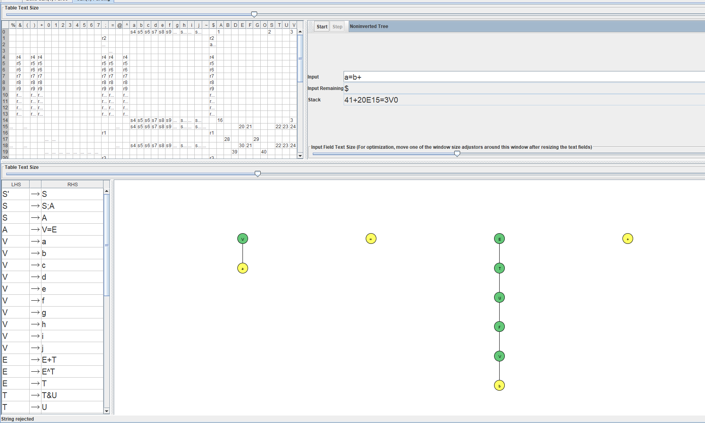

# Распознавание тестовых цепочек

| № | Цепочка | Результат | Что проверяется |
|---:|---|---|---|
| 1 | `a=%101` | Accepted | двоичная константа |
| 2 | `b=@17` | Accepted | восьмеричная константа |
| 3 | `c=~a&%1+@7;d=(a^b)&c` | Accepted | все операции, скобки, два оператора |
| 4 | `a=%10;b=@77;c=d` | Accepted | последовательность из трёх операторов |
| 5 | `a=%102` | Rejected | цифра 2 в двоичной константе |
| 6 | `a=b+` | Rejected | отсутствует правый операнд |

**1. `a=%101` — принято.**

**2. `b=@17` — принято.**

**3. `c=~a&%1+@7;d=(a^b)&c` — принято.**

**4. `a=%10;b=@77;c=d` — принято.**

**5. `a=%102` — отклонено.**

**6. `a=b+` — отклонено.**

