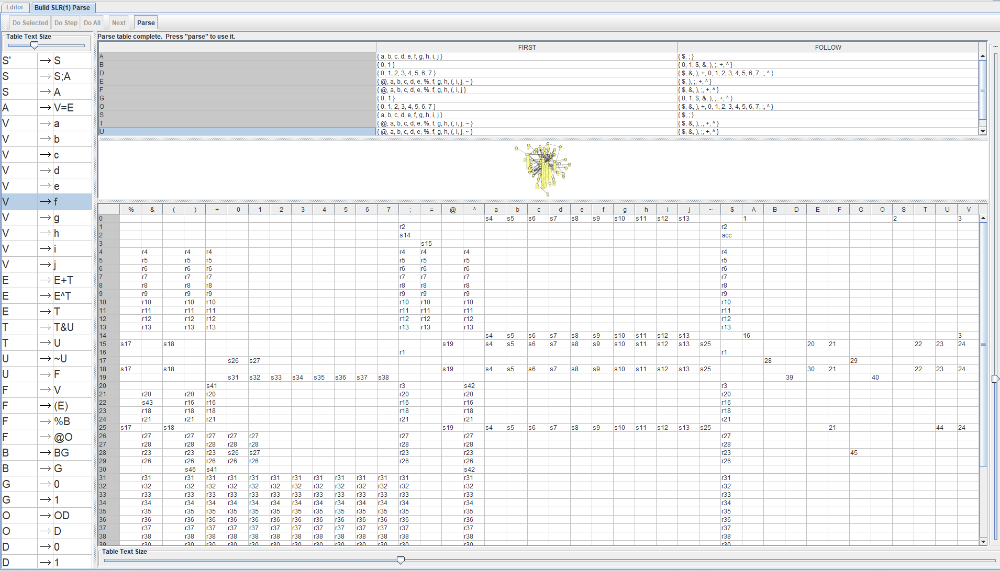

# Полученная SLR(1)-грамматика

**Файл модели:** [`grammar_slr1.jff`](grammar_slr1.jff). 


## Продукции

```text
S -> S;A | A
A -> V=E
V -> a | b | c | d | e | f | g | h | i | j
E -> E+T | E^T | T
T -> T&U | U
U -> ~U | F
F -> V | (E) | %B | @O
B -> BG | G
G -> 0 | 1
O -> OD | D
D -> 0 | 1 | 2 | 3 | 4 | 5 | 6 | 7
```

`B` — двоичные цифры после `%`, `O` — восьмеричные цифры после `@`.

## Множества FIRST и FOLLOW

| Нетерминал | FIRST | FOLLOW |
|---|---|---|
| `S`, `A` | `a`–`j` | `$ ;` |
| `V` | `a`–`j` | `$ & ) + ; = ^` |
| `E` | `% ( @ ~ a`–`j` | `$ ) + ; ^` |
| `T`, `U` | `% ( @ ~ a`–`j` | `$ & ) + ; ^` |
| `F` | `% ( @ a`–`j` | `$ & ) + ; ^` |
| `B`, `G` | `0 1` | `$ & ) + 0 1 ; ^` |
| `O`, `D` | `0`–`7` | `$ & ) + 0`–`7` `; ^` |


## Канонический набор LR(0)-ситуаций

Грамматика дополнена правилом `S' → S`, получено 51 состояние. Запись `V → •a|…|•j` означает десять ситуаций `V → •a`, …, `V → •j`; так же для `G` и `D`. Замыкание «Z» ниже обозначает набор `V → •a|…|•j`, `U → •~U`, `U → •F`, `F → •V`, `F → •(E)`, `F → •%B`, `F → •@O`.

```text
I0:  S'→•S; S→•S;A; S→•A; A→•V=E; V→•a|…|•j
I1:  S'→S•; S→S•;A
I2:  S→A•
I3:  A→V•=E
I4…I13: V→a•, V→b•, …, V→j•  (I4 для a, …, I13 для j)
I14: S→S;•A; A→•V=E; V→•a|…|•j
I15: A→V=•E; E→•E+T; E→•E^T; E→•T; T→•T&U; T→•U; Z
I16: S→S;A•
I17: A→V=E•; E→E•+T; E→E•^T
I18: E→T•; T→T•&U
I19: T→U•
I20: U→~•U; Z
I21: U→F•
I22: F→V•
I23: F→(•E); E→•E+T; E→•E^T; E→•T; T→•T&U; T→•U; Z
I24: F→%•B; B→•BG; B→•G; G→•0|•1
I25: F→@•O; O→•OD; O→•D; D→•0|•1|…|•7
I26: E→E+•T; T→•T&U; T→•U; Z
I27: E→E^•T; T→•T&U; T→•U; Z
I28: T→T&•U; Z
I29: U→~U•
I30: F→(E•); E→E•+T; E→E•^T
I31: F→%B•; B→B•G; G→•0|•1
I32: B→G•
I33: G→0•
I34: G→1•
I35: F→@O•; O→O•D; D→•0|•1|…|•7
I36: O→D•
I37…I44: D→0•, D→1•, …, D→7•
I45: E→E+T•; T→T•&U
I46: E→E^T•; T→T•&U
I47: T→T&U•
I48: F→(E)•
I49: B→BG•
I50: O→OD•
```

## Таблица ACTION/GOTO

Продукции пронумерованы по порядку записи: 0 `S'→S`; 1 `S→S;A`; 2 `S→A`; 3 `A→V=E`; 4–13 `V→a…j`; 14 `E→E+T`; 15 `E→E^T`; 16 `E→T`; 17 `T→T&U`; 18 `T→U`; 19 `U→~U`; 20 `U→F`; 21 `F→V`; 22 `F→(E)`; 23 `F→%B`; 24 `F→@O`; 25 `B→BG`; 26 `B→G`; 27 `G→0`; 28 `G→1`; 29 `O→OD`; 30 `O→D`; 31–38 `D→0…7`.

`sN` — перенос в состояние N, `rN` — свёртка по продукции N, `acc` — принятие; пустые клетки — ошибка. Запись `a`–`j`: s4–s13 означает переносы `a`→s4, `b`→s5, …, `j`→s13.

| Сост. | ACTION | GOTO |
|---:|---|---|
| 0, 14 | `a`–`j`: s4–s13 | 0: `S`1 `A`2 `V`3; 14: `A`16 `V`3 |
| 1 | `;`: s14, `$`: acc | — |
| 2 | `; $`: r2 | — |
| 3 | `=`: s15 | — |
| 4–13 | `& ) + ; = ^ $`: r4 … r13 соответственно | — |
| 15 | `%`: s24, `(`: s23, `@`: s25, `~`: s20, `a`–`j`: s4–s13 | `V`22 `E`17 `T`18 `U`19 `F`21 |
| 16 | `; $`: r1 | — |
| 17 | `+`: s26, `^`: s27, `; $`: r3 | — |
| 18 | `&`: s28, `) + ; ^ $`: r16 | — |
| 19 | `& ) + ; ^ $`: r18 | — |
| 20 | как в 15 | `V`22 `U`29 `F`21 |
| 21 | `& ) + ; ^ $`: r20 | — |
| 22 | `& ) + ; ^ $`: r21 | — |
| 23 | как в 15 | `V`22 `E`30 `T`18 `U`19 `F`21 |
| 24 | `0`: s33, `1`: s34 | `B`31 `G`32 |
| 25 | `0`–`7`: s37–s44 | `O`35 `D`36 |
| 26 | как в 15 | `V`22 `T`45 `U`19 `F`21 |
| 27 | как в 15 | `V`22 `T`46 `U`19 `F`21 |
| 28 | как в 15 | `V`22 `U`47 `F`21 |
| 29 | `& ) + ; ^ $`: r19 | — |
| 30 | `)`: s48, `+`: s26, `^`: s27 | — |
| 31 | `0`: s33, `1`: s34, `& ) + ; ^ $`: r23 | `G`49 |
| 32–34 | `& ) + 0 1 ; ^ $`: r26, r27, r28 соответственно | — |
| 35 | `0`–`7`: s37–s44, `& ) + ; ^ $`: r24 | `D`50 |
| 36–44 | `& ) + 0`–`7` `; ^ $`: r30, r31 … r38 соответственно | — |
| 45 | `&`: s28, `) + ; ^ $`: r14 | — |
| 46 | `&`: s28, `) + ; ^ $`: r15 | — |
| 47 | `& ) + ; ^ $`: r17 | — |
| 48 | `& ) + ; ^ $`: r22 | — |
| 49 | `& ) + 0 1 ; ^ $`: r25 | — |
| 50 | `& ) + 0`–`7` `; ^ $`: r29 | — |

FIRST, FOLLOW, LR(0)-автомат и таблица ACTION/GOTO в JFLAP:


**Вывод.** Свёртки записаны только на символах `FOLLOW` левой части, ни в одной клетке нет двух действий: конфликтов «перенос/свёртка» и «свёртка/свёртка» нет. Грамматика принадлежит классу SLR(1).
